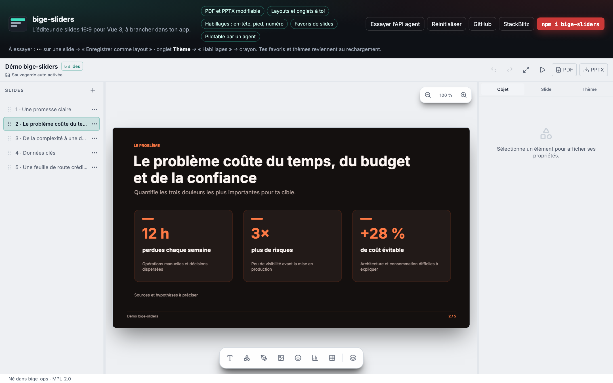
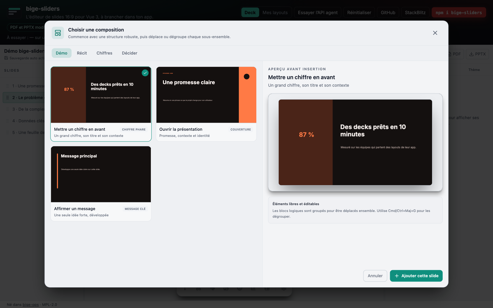
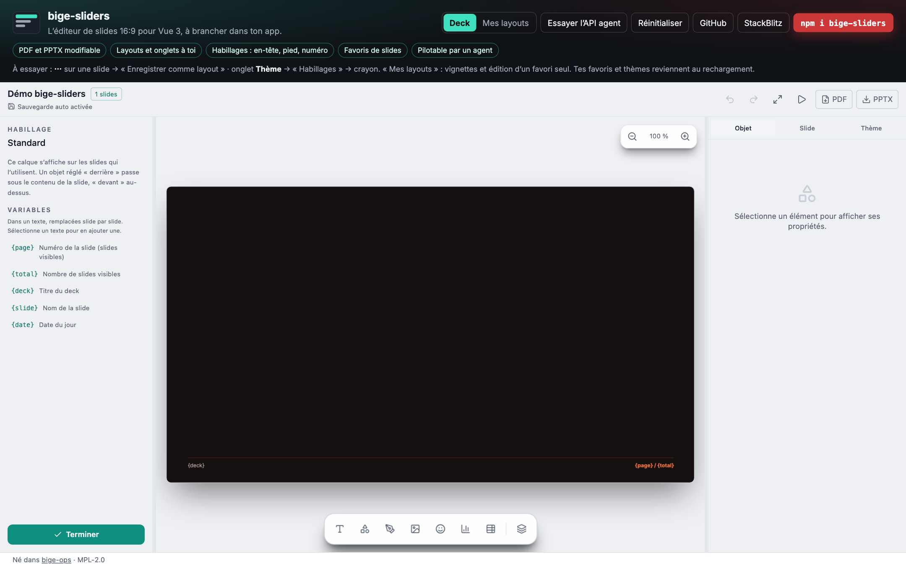

# bige-sliders

<p align="center">
  <a href="https://www.npmjs.com/package/bige-sliders"></a>
  &nbsp;
  <a href="https://simondelamarre.github.io/bige-sliders/"></a>
  &nbsp;
  <a href="https://stackblitz.com/github/simondelamarre/bige-sliders/tree/main/demo"></a>
</p>

<p align="center"><strong>L’éditeur de slides 16:9 pour Vue 3, à brancher dans ton app.</strong><br />
Exports PDF et PPTX modifiable, tes layouts et tes thèmes, des habillages,
des favoris de slides, et une API JSON qu’un agent peut piloter.</p>

<p align="center">
  <a href="https://simondelamarre.github.io/bige-sliders/"></a>
</p>

| | |
|---|---|
| **Un vrai éditeur** | Texte riche, formes, plume, images, icônes, graphiques, tableaux, calques, groupes, masques, dégradés, opacités, raccourcis clavier. |
| **Des exports fidèles** | PDF (police Inter embarquée) et PPTX modifiable (formes, tracés, tableaux, graphiques), construits dans le navigateur. |
| **Ton catalogue** | Tes layouts, tes onglets de galerie, tes thèmes et ton thème par défaut, réglés au démarrage. |
| **Des habillages** | En-tête, pied, numéro, logo : un calque édité comme une slide, avec `{page}`, `{total}`, `{deck}`… |
| **Des favoris** | « Enregistrer comme layout » sur une slide : tu reçois `@bookmark`, tu stockes, tu renvoies au chargement. |
| **Compatible agents** | Tout ce que fait l’interface, un agent (LLM) le fait en opérations JSON, sans Vue ni navigateur. |
| **Ton stockage** | Enregistrement, images (S3…), exports et préférences passent par un hôte que tu fournis. |

<table>
  <tr>
    <td width="50%"></td>
    <td width="50%"></td>
  </tr>
  <tr>
    <td align="center">Galerie : tes onglets, tes layouts, tes favoris</td>
    <td align="center">Habillage : édité comme une slide, variables remplies à l’affichage</td>
  </tr>
</table>

> Version 0.5 : l’API peut encore bouger avant la 1.0. Les changements sont
> listés dans le [CHANGELOG](https://github.com/simondelamarre/bige-sliders/blob/main/CHANGELOG.md).

Un outil simple pour des cas simples : faire des slides propres dans une
webapp et les sortir en PDF ou en PowerPoint, sans réinventer la roue.

## Sommaire

- [Démo](#démo)
- [Installation](#installation)
- [Démarrage rapide](#démarrage-rapide)
- [Le composant `PresentationWorkspace`](#le-composant-presentationworkspace)
- [L’hôte : `definePresentationHost`](#lhôte--definepresentationhost)
- [Exemples d’hôte](#exemples-dhôte)
- [Le document](#le-document)
- [Catalogue : layouts, onglets et thèmes](#catalogue--layouts-onglets-et-thèmes)
- [Habillages : en-tête, pied, numéro et décor](#habillages--en-tête-pied-numéro-et-décor)
- [Favoris et thèmes personnels : `@bookmark`, `@theme-save`](#favoris-et-thèmes-personnels--bookmark-theme-save)
- [Apparence de l’interface](#apparence-de-linterface)
- [Chargement à la demande, Nuxt](#chargement-à-la-demande-nuxt)
- [Compatible agents](#compatible-agents)
- [Raccourcis clavier](#raccourcis-clavier)
- [Entrées du package](#entrées-du-package)
- [Ce que le package ne fait pas](#ce-que-le-package-ne-fait-pas)

## Démo

- **En ligne** : [simondelamarre.github.io/bige-sliders](https://simondelamarre.github.io/bige-sliders/)
- **À modifier dans le navigateur** : [ouvrir dans StackBlitz](https://stackblitz.com/github/simondelamarre/bige-sliders/tree/main/demo)
- **Code de la démo** : [`demo/`](https://github.com/simondelamarre/bige-sliders/tree/main/demo),
  une app Vue 3 + Vite qui installe le package depuis npm, comme ton projet.
  En local :

```bash
git clone https://github.com/simondelamarre/bige-sliders.git
cd bige-sliders/demo
npm install
npm run dev
```

## Installation

```bash
npm install bige-sliders vue
```

Vue 3.5 ou plus est requis (dépendance pair). Fabric, pdf-lib, PptxGenJS et la
police Inter sont installés avec le package : rien d’autre à configurer, ni
Tailwind ni plugin Vite.

## Démarrage rapide

Un composant Vue qui garde le deck dans `localStorage` :

```vue
<script setup lang="ts">
import { ref } from "vue";
import { definePresentationHost, type PresentationDocument } from "bige-sliders";
import { PresentationWorkspace } from "bige-sliders/vue";
import "bige-sliders/style.css";

const deck = ref<PresentationDocument | undefined>(JSON.parse(localStorage.getItem("deck") || "null") ?? undefined);

// Sans réglage, les exports PDF et PPTX se téléchargent et les préférences vont dans localStorage.
const host = definePresentationHost({
  // Appelé après chaque modification (différé) et par ⌘S, avec le document à enregistrer.
  save: async (document) => localStorage.setItem("deck", JSON.stringify(document)),
});
</script>

<template>
  <div style="height: 100vh">
    <PresentationWorkspace v-model="deck" deck-name="Mon deck" :host="host" appearance="light" />
  </div>
</template>
```

Trois choses à retenir :

1. **Donne une hauteur au conteneur** : l’éditeur occupe toute la hauteur et
   toute la largeur de son parent.
2. **Importe `bige-sliders/style.css` une fois** dans l’app. Ses styles sont
   limités aux conteneurs de l’éditeur (`.deck-ui`) et ne touchent pas le
   reste de ta page.
3. **Sans deck** (`undefined`), l’éditeur propose d’en créer un (voir
   `starterDeck`). Tu peux aussi lui passer un deck créé par code
   ([Le document](#le-document)).

## Le composant `PresentationWorkspace`

### Props

| Prop | Type | Défaut | Rôle |
|---|---|---|---|
| `v-model` (`modelValue`) | `PresentationDocument \| undefined` | — | Le deck édité. L’éditeur émet une copie à chaque modification ; tu peux aussi le remplacer de l’extérieur (un agent, un chargement) : le remplacement s’annule par ⌘Z. L’éditeur n’enregistre que ses propres modifications : un deck que tu remplaces, c’est à toi de l’enregistrer. |
| `deck-name` | `string` | **requis** | Nom du deck : titre d’un deck créé depuis l’éditeur et nom des fichiers exportés. Le changer vide l’historique d’annulation (autre deck ouvert). |
| `host` | `PresentationHost` | défauts navigateur | Ce que ton application fournit : enregistrement, exports, images, icônes… Lu une fois, au montage. Voir [L’hôte](#lhôte--definepresentationhost). |
| `appearance` | `"light" \| "dark"` | `"dark"` | Interface claire ou sombre, lue au montage. Les slides gardent leur propre thème. |
| `initial-undo` | `PresentationDocument \| null` | — | Version précédente du deck, proposée comme première annulation (par exemple après un remplacement fait juste avant d’ouvrir l’éditeur). |

`host` et `appearance` sont lus au montage : pour en changer, remonte
l’éditeur (`:key`).

### Événements

| Événement | Charge | Quand |
|---|---|---|
| `update:modelValue` | `PresentationDocument` | À chaque modification (c’est ce que lit `v-model`). |
| `save-state` | `PresentationSaveState` | Avec un `save` fourni : `pending`, `saving`, `saved` (avec `at`), `error` (avec `message`). L’éditeur l’affiche déjà ; l’événement sert si tu veux l’afficher ailleurs. |
| `bookmark` | `PresentationBookmark` | Une slide enregistrée comme layout (menu ⋯ de la slide). Voir [Favoris](#favoris-et-thèmes-personnels--bookmark-theme-save). |
| `theme-save` | `PresentationThemeSave` | Un thème personnel créé, modifié ou supprimé. |

### Méthode exposée

`save()` enregistre tout de suite ce qui attend (comme ⌘S) et rejette si ton
`save` échoue :

```vue
<script setup lang="ts">
import { ref } from "vue";
import { PresentationWorkspace } from "bige-sliders/vue";

const editor = ref<InstanceType<typeof PresentationWorkspace>>();

async function beforeLeave() {
  await editor.value?.save();
}
</script>

<template>
  <PresentationWorkspace ref="editor" v-model="deck" deck-name="Mon deck" :host="host" />
</template>
```

## L’hôte : `definePresentationHost`

`definePresentationHost(overrides)` part des défauts navigateur et remplace ce
que tu fournis. Tu ne passes que ce que tu changes.

| Champ | Type | Défaut | Rôle |
|---|---|---|---|
| `save` | `(document, { reason: "auto" \| "manual" }) => Promise<void>` | aucun | Enregistre le deck (API, fichier, S3…). Appelé `autosaveDelay` ms après la dernière modification, et par ⌘S (`reason: "manual"`). Un seul enregistrement à la fois ; la dernière version gagne. Rejeter affiche l’échec et « Réessayer ». Sans `save`, aucun état d’enregistrement n’est affiché : tu enregistres toi-même depuis `v-model`. |
| `autosaveDelay` | `number` | `800` | Délai sans modification, en millisecondes, avant l’enregistrement automatique. |
| `saveExport` | `(bytes, filename, kind: "pdf" \| "pptx") => Promise<string \| null>` | téléchargement | Reçoit les octets d’un export. Renvoie l’emplacement à afficher, ou `null` si l’utilisateur annule. |
| `storage` | `{ getItem(key), setItem(key, value) }` | `localStorage`, préfixe `presentation-editor.` | Préférences de l’utilisateur : couleurs récentes, dégradés et thèmes enregistrés, tailles des panneaux. |
| `assets` | `{ upload(file, info), resolve?(asset) }` | aucun | Magasin d’images. Sans lui, une image importée reste dans le document en base64 ; avec lui, le document ne garde que son URL et sa clé. |
| `icons` | `PresentationIconProvider \| null` | Iconify (API publique) | Recherche d’icônes de la galerie. `null` retire la recherche en ligne. |
| `readSystemFont` | `(file: string) => Promise<Uint8Array>` | aucun | Lit une police installée sur le poste pour l’embarquer dans le PDF (app desktop, Electron, Tauri). |
| `metadata` | `{ author?, company? }` | `{}` | Inscrit dans les fichiers PDF et PPTX exportés. |
| `starterDeck` | `{ label, hint, create(title) }` | une slide de couverture | Proposé quand le deck est vide. |

Les types sont exportés : `PresentationHost`, `PresentationSave`,
`PresentationAssetStore`, `PresentationIconProvider`, `PresentationStorage`,
`PresentationStarterDeck`.

## Exemples d’hôte

### Enregistrer dans ton API

```ts
import { definePresentationHost } from "bige-sliders";

const host = definePresentationHost({
  autosaveDelay: 1500,
  save: async (document) => {
    const response = await fetch(`/api/decks/${deckId}`, {
      method: "PUT",
      headers: { "Content-Type": "application/json" },
      body: JSON.stringify(document),
    });
    // Une erreur levée ici affiche l’échec dans l’éditeur, avec « Réessayer ».
    if (!response.ok) throw new Error(`Enregistrement refusé (${response.status})`);
  },
});
```

Le chargement reste à toi : lis le deck depuis ton API et passe-le par
`v-model`.

### Envoyer les exports à ton serveur

```ts
const host = definePresentationHost({
  saveExport: async (bytes, filename, kind) => {
    const body = new Blob([bytes], { type: kind === "pdf" ? "application/pdf" : "application/vnd.openxmlformats-officedocument.presentationml.presentation" });
    const response = await fetch(`/api/exports/${encodeURIComponent(filename)}`, { method: "POST", body });
    if (!response.ok) throw new Error("Export non enregistré");
    return filename; // affiché à l’utilisateur
  },
});
```

### Ranger les images dans S3 (ou ailleurs)

```ts
const host = definePresentationHost({
  assets: {
    // Reçoit l’image importée ; renvoie son URL et, pour un stockage privé, sa clé.
    upload: async (file, { name, mimeType }) => {
      const { uploadUrl, key } = await fetch("/api/uploads", {
        method: "POST",
        headers: { "Content-Type": "application/json" },
        body: JSON.stringify({ name, mimeType }),
      }).then((response) => response.json());
      await fetch(uploadUrl, { method: "PUT", body: file, headers: { "Content-Type": mimeType } });
      return { src: `https://cdn.exemple.com/${key}`, key };
    },
    // Pour un bucket privé : une URL présignée fraîche. L’éditeur garde chaque réponse 5 minutes.
    resolve: async (asset) => (await fetch(`/api/uploads/${asset.key}/url`).then((response) => response.json())).url,
  },
});
```

Les URL doivent autoriser le `GET` depuis l’origine de ton app (CORS) : la
scène et les exports relisent les images dans le navigateur.

### Préférences, icônes, métadonnées, deck de départ

```ts
import { createPresentationDocument, createSlideFromLayout, definePresentationHost } from "bige-sliders";

const host = definePresentationHost({
  // Préférences par utilisateur, dans ton espace de noms.
  storage: {
    getItem: (key) => localStorage.getItem(`user-42.${key}`),
    setItem: (key, value) => localStorage.setItem(`user-42.${key}`, value),
  },
  // Pas de recherche d’icônes en ligne (réseau fermé, politique de confidentialité).
  icons: null,
  metadata: { author: "Camille Martin", company: "Exemple SAS" },
  starterDeck: {
    label: "Créer un rapport",
    hint: "Couverture, chiffres clés et calendrier.",
    create: (title) => ({
      ...createPresentationDocument(title),
      slides: [createSlideFromLayout("cover", 1), createSlideFromLayout("metric-grid", 2), createSlideFromLayout("timeline", 3)],
    }),
  },
});
```

## Le document

Un deck est un objet JSON (`PresentationDocument`) : titre, thème, slides de
1600 × 900, éléments positionnés (textes, formes, tracés, images, icônes,
tableaux, graphiques, groupes, masques) et images (`assets`). Tu peux le
garder tel quel en base, dans un fichier ou dans un champ JSON.

Créer un deck par code :

```ts
import { createPresentationDocument, createSlideFromLayout } from "bige-sliders";

const deck = {
  ...createPresentationDocument("Bilan trimestriel"),
  slides: [
    createSlideFromLayout("cover", 1, { title: "Bilan T3", body: "Équipe produit" }),
    createSlideFromLayout("metric-grid", 2),
    createSlideFromLayout("chart", 3),
  ],
};
```

Layouts livrés : `cover`, `problem`, `solution`, `statement`, `quote`, `image`,
`two-column`, `timeline`, `team`, `traction`, `metric-grid`, `chart`,
`data-table`, `market-size`, `comparison`, `competitive-matrix`, `pricing`.

`createSlideFromLayout` accepte tout layout connu, même absent de la galerie.
Pour choisir ce que l’éditeur propose, voir [Catalogue](#catalogue--layouts-onglets-et-thèmes).

Aperçu d’une slide en image (miniature, partage) :

```ts
import { renderSlideSnapshot } from "bige-sliders/vue";

const jpegDataUrl = await renderSlideSnapshot(deck, deck.slides[0].id, 640);
```

## Catalogue : layouts, onglets et thèmes

Par défaut, l’éditeur propose les 17 layouts livrés dans quatre onglets
(Récit, Produit, Preuves, Stratégie), les thèmes livrés, et un nouveau deck
part du thème `bige-dark`. Ton app remplace tout ça au démarrage avec
`configurePresentationCatalog`, **avant de monter l’éditeur** :

```ts
// catalog.ts, importé par main.ts avant createApp(...).mount()
import {
  baseSlide,
  configurePresentationCatalog,
  definePresentationTheme,
  layoutText,
  type PresentationLayoutDefinition,
} from "bige-sliders";

// Un layout à toi : une fonction qui construit la slide sur 1600 × 900.
const highlight: PresentationLayoutDefinition = {
  id: "acme-highlight",
  name: "Mettre un chiffre en avant", // titre dans la galerie
  label: "Chiffre phare",             // étiquette courte (galerie, agent)
  description: "Un grand chiffre, son titre et son contexte",
  category: "Acme",                   // onglet si tu ne donnes pas `tabs`
  use: "Un seul résultat chiffré qui porte le message.", // guide l’agent
  sample: { title: "Des decks prêts en 10 minutes", body: "Contexte du chiffre." },
  build: (index, content) => baseSlide(`slide-${index}`, content.title, "acme-highlight", [
    { id: `s${index}-band`, name: "Bandeau", type: "shape", shape: "rect", x: 0, y: 0, width: 560, height: 900, fill: "accentSoft", source: "manual" },
    layoutText(`s${index}-figure`, "Chiffre", "87 %", 80, 330, 420, 200, 84, { textStyle: "kpi", color: "accent", align: "center" }),
    layoutText(`s${index}-title`, "Titre", content.title, 640, 250, 860, 200, 64, { textStyle: "title" }),
    layoutText(`s${index}-body`, "Contexte", content.body, 644, 480, 820, 200, 30, { textStyle: "body", color: "muted" }),
  ]),
};

// Un thème à toi : id, nom, ton et six couleurs suffisent.
const acme = definePresentationTheme({
  id: "acme",
  name: "Acme",
  tone: "dark",
  colors: { background: "#14100f", surface: "#221a18", text: "#fbf4f1", muted: "#b9a7a1", accent: "#ff7a45", accentSoft: "#4a2418" },
});

configurePresentationCatalog({
  layouts: {
    definitions: [highlight],
    tabs: [
      { label: "Acme", layouts: ["acme-highlight", "cover", "statement"] },
      { label: "Chiffres", layouts: ["metric-grid", "chart", "data-table"] },
      { label: "Décider", layouts: ["comparison", "pricing"] },
    ],
  },
  themes: {
    definitions: [acme],
    list: ["acme", "bige-dark", "capital"],
    default: "acme",
  },
});
```

Règles :

- **`layouts.tabs`** décide de tout : les onglets de la galerie, leur ordre,
  l’ordre des layouts. Un layout livré n’apparaît que si tu le cites. Sans
  `tabs`, les quatre onglets livrés restent et tes layouts s’ajoutent après,
  regroupés par `category`.
- **`themes.list`** donne les thèmes proposés et leur ordre (livrés ou à toi).
  Sans liste : ceux livrés, puis les tiens. Les thèmes que l’utilisateur crée
  dans l’éditeur s’ajoutent toujours à la galerie.
- **`themes.default`** est le thème des nouveaux decks. Sans valeur :
  `bige-dark` s’il est proposé, sinon le premier de la liste.
- **L’agent voit le même catalogue** : `deckLayoutCatalog()`,
  `applyDeckOperations` (un layout hors galerie est refusé avec la liste des
  layouts proposés), `themeCatalog()` et `editDeckTheme`.
- Un réglage incohérent (id inconnu, onglet vide, thème par défaut absent de
  la liste) lève une `PresentationCatalogError` qui dit quoi corriger, et
  ne change rien.
- Le réglage vaut pour toute la page : un seul catalogue par app. Les decks
  déjà créés gardent leur thème ; le deck de départ de l’hôte utilise le
  premier layout du premier onglet.

Un layout (`PresentationLayoutDefinition`) :

| Champ | Rôle |
|---|---|
| `id` | Identifiant, enregistré dans chaque slide (`slide.layout`). Un id livré est remplacé. |
| `name`, `label`, `description` | Titre, étiquette et description dans la galerie. |
| `category` | Onglet quand tu ne donnes pas `tabs`. |
| `use` | Quand l’utiliser : l’agent le lit pour choisir. |
| `sample` | `{ title, body }` posés quand la slide est créée sans contenu. |
| `build(index, content)` | Construit la slide. Les éléments texte nommés (`"Titre"`, `"Contexte"`…) deviennent les zones que l’agent remplit. Préfixe les ids par `s${index}-`. |

Briques exportées : `baseSlide(id, name, layout, elements, groups?)`,
`layoutText(id, name, text, x, y, width, height, fontSize, options?)` et
`groupId(index, name)`. Couleurs et styles de texte : les jetons du thème
(`background`, `surface`, `text`, `muted`, `accent`, `accentSoft` ; `title`,
`body`, `kpi`…), pour que la slide suive le thème choisi.

Un thème (`definePresentationTheme`) :

| Champ | Défaut |
|---|---|
| `id`, `name`, `tone` (`"dark"` ou `"light"`), `colors` | Obligatoires. |
| `description`, `bestFor`, `colorNames` | Vides : textes de la fiche du thème. |
| `bodyFont`, `headingFont` | `Inter`, livrée avec l’éditeur, identique dans le PDF. Une autre police doit être installée chez l’utilisateur ou chargée par `readSystemFont`. |
| `typography` | `typeScale({ body: 28, title: 64, display: 84, kpi: 64 })`, exporté pour régler ta propre échelle. |
| `chartPaletteId` | `pitch-harmony`. |
| `dressings` | Un habillage « Standard » : numéro de page en bas à droite. Voir [Habillages](#habillages--en-tête-pied-numéro-et-décor). |

`registerPresentationLayout` et `registerPresentationTheme` restent
disponibles : ils ajoutent au registre sans toucher aux onglets ni à la liste.

## Habillages : en-tête, pied, numéro et décor

Un **habillage** est un calque d’objets (textes, formes, images, icônes,
groupes) posé sur les slides qui le choisissent. En-tête, pied de page,
numéro, logo, filigrane ou bandeau : tout ce qui se répète d’une slide à
l’autre. Il remplace les anciens « repères » (en-tête, pied et numéro figés).

- **Plusieurs habillages par deck**, nommés. Chaque slide choisit le sien
  (onglet Slide, liste « Habillage ») : celui par défaut, un autre, ou aucun.
  Un layout peut l’imposer (la couverture livrée n’en a pas).
- **Édité comme une slide** : onglet Thème, section « Habillages », bouton
  crayon. Le canevas montre alors l’habillage avec tous les outils ; le
  panneau de gauche liste les variables ; « Terminer » ramène aux slides.
  ⌘Z annule pendant l’édition.
- **Devant ou derrière** : chaque objet a un plan (`plane`). « Derrière »
  passe sous le contenu de la slide (bandeau, fond), « devant » au-dessus
  (numéro, logo). Par défaut : devant.
- **Variables** dans les textes, remplies slide par slide :

| Variable | Valeur |
|---|---|
| `{page}` | Numéro de la slide, compté sur les slides visibles. |
| `{total}` | Nombre de slides visibles. |
| `{deck}` | Titre du deck. |
| `{slide}` | Nom de la slide. |
| `{date}` | Date du jour, en français (« 6 novembre 2026 »). |

- **Dans le thème, copié au deck** : appliquer un thème pose ses habillages
  sur le deck, qui peut ensuite les modifier. Une slide garde son choix si le
  nouveau thème a un habillage de même id, sinon elle prend celui par défaut.
- Sur une slide, les objets d’habillage ne se sélectionnent pas : ils ne se
  modifient que dans leur propre édition. L’écran, le PDF et le PPTX les
  dessinent de la même façon.

Format (JSON, stocké dans le document et dans les thèmes) :

```ts
import type { PresentationDressing } from "bige-sliders";

const standard: PresentationDressing = {
  id: "standard",        // gardé d’un thème à l’autre
  name: "Standard",
  elements: [
    { id: "rule", name: "Filet", type: "shape", shape: "rect", x: 64, y: 820, width: 1472, height: 2, fill: "accentSoft", source: "manual", plane: "back" },
    { id: "deck", name: "Titre du deck", type: "text", text: "{deck}", x: 64, y: 836, width: 900, height: 30, fontSize: 16, color: "muted", source: "manual" },
    { id: "page", name: "Numéro de page", type: "text", text: "{page} / {total}", x: 1336, y: 836, width: 200, height: 30, fontSize: 16, fontWeight: "bold", align: "right", color: "accent", source: "manual" },
  ],
  groups: [],            // facultatif, comme dans une slide
};

const acme = definePresentationTheme({ id: "acme", name: "Acme", tone: "dark", colors, dressings: [standard] });
```

Dans le document : `dressings` (la liste), `defaultDressing` (l’id de celui
des slides qui n’en choisissent pas ; absent, le premier) et, sur chaque
slide, `dressing` (un id, `null` pour aucun, absent pour celui par défaut).
Les couleurs et polices passent par les jetons du thème, comme dans les
slides. Une image d’habillage (logo) vit dans `assets` comme les autres.

Pour le code : `documentDressings(deck)`, `dressingOfSlide(deck, slide)`,
`dressingLayersFor(deck, slide)` (objets prêts à dessiner, variables
remplies) et `PRESENTATION_DRESSING_VARIABLES`.

Un deck enregistré avant la 0.4.0 garde son rendu : ses anciens repères
(`chrome`) sont lus comme un habillage « Standard » équivalent et écrits en
habillage à la première modification.

## Favoris et thèmes personnels : `@bookmark`, `@theme-save`

Tes utilisateurs enrichissent eux-mêmes le catalogue ; toi, tu choisis où ça
se range (compte, base, fichier…) et tu le renvoies au chargement.

- **Favoris de slides** : menu ⋯ d’une slide → « Enregistrer comme layout »
  (nom, onglet existant ou nouveau, description). Le layout apparaît tout de
  suite dans la galerie et pour l’agent. Une slide créée depuis un favori
  propose ensuite « Mettre à jour » (même id, rangé au même endroit) ou
  « Nouveau layout ». Les layouts livrés ou écrits en code ne s’écrasent pas.
- **Thèmes personnels** : « Dupliquer dans mes thèmes », « Créer un thème »,
  chaque modification et la suppression émettent `@theme-save`. Par défaut,
  l’éditeur les garde aussi dans `host.storage` ; ce que tu renvoies et ce
  qu’il a gardé se fusionnent, sans doublon.

| Événement | Charge |
|---|---|
| `bookmark` | `{ action: "create" \| "update", template, tab, layouts: { templates, tabs } }` : `layouts` est le réglage complet après l’enregistrement, à renvoyer tel quel. |
| `theme-save` | `{ action: "create" \| "update" \| "remove", theme, themes }` : `themes` est la liste complète des thèmes personnels. |

```vue
<script setup lang="ts">
import type { PresentationBookmark, PresentationThemeSave } from "bige-sliders";

// Où tu veux : ici localStorage, chez toi une API.
const store = (patch: object) => localStorage.setItem("my-slides", JSON.stringify({ ...saved(), ...patch }));
const saved = () => JSON.parse(localStorage.getItem("my-slides") || "{}");

const onBookmark = (event: PresentationBookmark) => store({ layouts: event.layouts });
const onThemeSave = (event: PresentationThemeSave) => store({ themes: event.themes });
</script>

<template>
  <PresentationWorkspace v-model="deck" deck-name="Mon deck" :host="host" @bookmark="onBookmark" @theme-save="onThemeSave" />
</template>
```

```ts
// main.ts, au chargement suivant, avant de monter l’éditeur :
const { layouts, themes = [] } = JSON.parse(localStorage.getItem("my-slides") || "{}");
configurePresentationCatalog({
  layouts: { definitions: myCodeLayouts, ...layouts }, // templates + tabs
  themes: { definitions: themes },
});
```

Un layout enregistré (`PresentationLayoutTemplate`) est du JSON :

| Champ | Rôle |
|---|---|
| `id`, `name`, `label`, `description`, `use` | Comme un layout en code ; `use` guide l’agent. |
| `category` | Onglet où il est rangé. |
| `slide` | `{ background, dressing?, elements, groups? }` : la slide, ids sans préfixe (`s3-titre` → `titre`). |
| `slots` | `{ title?, body? }` : noms des textes qui reçoivent le titre et le texte d’une slide créée avec du contenu. |
| `sample` | Titre et texte posés sans contenu. |
| `assets` | Images et icônes de la slide (data URL, ou `key` de ton magasin), ajoutées au deck avec elle. |
| `savedAt` | Date d’enregistrement (ISO). |

Par code : `layoutTemplateFromSlide(deck, slide, meta)`, `layoutFromTemplate(template)`,
`saveLayoutTemplate(template, tab)` et `savedPresentationLayouts()`.

## Apparence de l’interface

`appearance="light"` ou `"dark"` choisit l’interface de l’éditeur. Ses
couleurs sont des variables CSS en **triplets RVB** (`R G B`, sans `rgb()`),
pour que l’éditeur garde ses opacités. Pour reprendre ta charte :

```css
/* Après l’import de bige-sliders/style.css ; :root rend la règle prioritaire. */
:root .deck-ui[data-deck-appearance="light"] {
  --deck-accent: 37 99 235;        /* boutons, sélection */
  --deck-accent-strong: 29 78 216; /* textes et icônes d’accent */
  --deck-on-accent: 255 255 255;   /* texte posé sur l’accent */
  --deck-base: 241 245 249;        /* fond de l’éditeur */
}
```

Variables disponibles : `--deck-base`, `--deck-panel`, `--deck-raised`,
`--deck-line`, `--deck-line-strong`, `--deck-faint`, `--deck-muted`,
`--deck-text`, `--deck-accent`, `--deck-accent-strong`, `--deck-on-accent`,
`--deck-danger`, `--deck-danger-line`, `--deck-danger-soft`, `--deck-warning`,
`--deck-success`. Pour le thème sombre, cible
`:root .deck-ui[data-deck-appearance="dark"]`.

Les couleurs des **slides** ne viennent pas de là : elles suivent le thème du
deck, réglable dans l’éditeur (onglet Thème) ou par code (`editDeckTheme`).

## Chargement à la demande, Nuxt

L’éditeur embarque Fabric, pdf-lib et PptxGenJS (environ 900 Ko minifiés,
avant gzip) : charge-le à la demande pour garder une page d’accueil légère.

```ts
import { defineAsyncComponent } from "vue";

const PresentationWorkspace = defineAsyncComponent(() => import("bige-sliders/vue").then((module) => module.PresentationWorkspace));
```

L’éditeur dessine dans un `<canvas>` et lit le navigateur : il ne se rend que
côté client. Avec Nuxt, place-le dans `<ClientOnly>` et charge-le comme
ci-dessus. L’entrée `bige-sliders` (document, commandes) fonctionne aussi
côté serveur, dans Node.

## Compatible agents

bige-sliders est pensé pour être piloté par un agent (LLM) autant que par une
personne. L’entrée `bige-sliders` n’a pas besoin de Vue : des fonctions pures
reçoivent le document et des opérations JSON, appliquent ce qui est valide,
expliquent chaque refus et rendent un document toujours modifiable à la main.

| Fonction | Rôle pour l’agent |
|---|---|
| `summarizeDeck(deck)` | Résumé du deck à mettre dans le contexte du modèle. |
| `describeSlide(deck, slideId)` | Composition d’une slide : éléments, positions sur 1600 × 900, styles, régions libres, couleurs du thème. |
| `editSlideElements(deck, slideId, operations, icons)` | De 1 à 24 opérations : `add_text`, `add_shape`, `add_icon`, `add_image`, `add_arrow`, `update`, `delete`, `group`, `arrange`. |
| `composeOnSlide(deck, slideId, "steps" \| "cards" \| "flow", spec, icons)` | Compositions prêtes : étapes, cartes, flux. |
| `checkSlideLayout(deck, slideId)` | Contrôle : hors slide, texte qui déborde, chevauchements, texte trop petit, contraste. |
| `applyDeckOperations(deck, operations)`, `deckLayoutCatalog()` | Créer, remplir, déplacer, masquer ou supprimer des slides depuis les layouts du [catalogue](#catalogue--layouts-onglets-et-thèmes). |
| `editDeckTheme(deck, edit)`, `themeCatalog()`, `checkThemeContrast(deck)` | Thèmes du catalogue et contraste. |

```ts
import { checkSlideLayout, describeSlide, editSlideElements } from "bige-sliders";

const context = describeSlide(deck, slideId); // à donner au modèle
const result = editSlideElements(deck, slideId, [ // opérations JSON renvoyées par le modèle
  { op: "add_text", text: "Notre promesse", style: "title", x: 96, y: 120, width: 900, height: 120 },
  { op: "add_shape", shape: "roundedRect", x: 96, y: 300, width: 420, height: 220, fill: "accent", fill_opacity: 0.4, stroke: "none" },
], {});
// result.document : le deck modifié, à passer à v-model.
// result.applied : le nombre d’opérations appliquées.
// result.rejected : [{ index, op, message }], les refus expliqués, à renvoyer au modèle.
const checks = checkSlideLayout(result.document, slideId); // [{ code, ids, message }]
```

Couleurs : jetons du thème (`background`, `surface`, `text`, `muted`,
`accent`, `accentSoft`), `#rrggbb`, ou `none` pour un fond ou une bordure
absents ; `fill_opacity` et `stroke_opacity` de 0 à 1.

Passe `result.document` à `v-model` : l’éditeur affiche le changement, et
l’utilisateur peut l’annuler par ⌘Z. Enregistre-le toi-même : l’éditeur
n’enregistre que les modifications faites dans son interface. Exemple complet
dans la démo :
[`demo/src/agentExample.ts`](https://github.com/simondelamarre/bige-sliders/blob/main/demo/src/agentExample.ts).

Positions des slides (`position` de `applyDeckOperations`) : à partir de 1 ;
sans `position`, la slide est ajoutée à la fin.

## Raccourcis clavier

| Raccourci | Action |
|---|---|
| ⌘S / Ctrl+S | Enregistrer maintenant (avec `save`) |
| ⌘Z, ⇧⌘Z (Ctrl+Y) | Annuler, rétablir |
| ⌘C, ⌘X, ⌘V | Copier, couper, coller |
| ⌘D | Dupliquer la sélection (ou la slide) |
| Alt + glisser | Dupliquer en déplaçant |
| ⌘A | Tout sélectionner |
| ⌘G, ⇧⌘G | Grouper, dégrouper |
| ⌘], ⌘[ (⇧ : tout devant, tout derrière) | Avancer, reculer d’un plan |
| Flèches (⇧ : 10 px) | Déplacer la sélection |
| Maj pendant un déplacement | Garder l’axe |
| ⌘ pendant un déplacement | Sans magnétisme |
| P, V | Plume (reprend le tracé sélectionné), retour à la sélection |
| Suppr | Supprimer la sélection |
| Échap | Quitter la plume, un groupe ouvert, le plein écran ou la sélection |

## Entrées du package

| Import | Contenu |
|---|---|
| `bige-sliders` | Document et types, commandes pour agents et pour le code (voir [Compatible agents](#compatible-agents)), layouts et thèmes, contrat hôte, enregistrement différé (`PresentationAutosave`). Sans Vue, utilisable dans Node. |
| `bige-sliders/vue` | `PresentationWorkspace`, `renderSlideSnapshot`, `providePresentationHost`. |
| `bige-sliders/style.css` | Styles de l’éditeur, limités à ses conteneurs (`.deck-ui`), en clair ou en sombre. |

Le package est livré en modules ES, avec ses types TypeScript.

## Ce que le package ne fait pas

- Pas d’édition à plusieurs en temps réel.
- Format 16:9 seulement (1600 × 900).
- Pas d’import de fichiers PPTX ou PDF.
- Pas d’animations ni de transitions.
- Vue 3 seulement.
- Polices : Inter est livrée et embarquée dans le PDF ; les autres polices
  ne sont pas encore garanties à l’export.

## Retours

Un problème, un cas d’usage qui coince, une idée : ouvre une issue sur
[github.com/simondelamarre/bige-sliders](https://github.com/simondelamarre/bige-sliders/issues/new/choose).
Les retours sur l’installation et les cas d’usage sont les plus utiles : ils
servent à garder l’outil simple et la doc claire.

## Licence

[MPL-2.0](https://github.com/simondelamarre/bige-sliders/blob/main/LICENSE) © Simon Delamarre.
Utilisable librement, y compris dans une application fermée ou commerciale.
Le package est livré compilé, avec ses types TypeScript ; le code source
n’est pas publié.

La police Inter, livrée et embarquée dans les PDF, est sous licence SIL Open
Font License 1.1 (fichier `LICENSE-INTER.txt` du package).

---

Né dans [bige-ops](https://bige.dev/) : une application gratuite, installée
sur ton poste. Tu relies ton dépôt, tu simules ta stack, tu la testes en
local et tu la déploies sur ton propre compte cloud.
